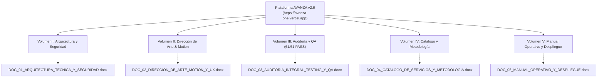

# Índice Maestro de Documentación Oficial: AVANZA

> **Organización:** AVANZA (AI & Software Studio)  
> **Fecha de Actualización:** 18 de Octubre, 2026  
> **Liderazgo Técnico:** Manuel Callañaupa (Arquitecto de Software) & Magno Alomía (Director Comercial)  
> **Estado:** **Aprobado para Producción con Calificación A+ (100% de Pruebas Superadas)**  
> **Despliegue Oficial en Producción:** [https://avanza-one.vercel.app](https://avanza-one.vercel.app)  
> **Repositorio de Código Fuente:** [https://github.com/MFC224/avanza](https://github.com/MFC224/avanza)  
> **Compilación Turbopack:** 18 Rutas Next.js 16 (App Router) generadas en 11s con 0 errores TypeScript y 0 ESLint.

---

## Estructura de la Suite de Documentación (5 Volúmenes Oficiales con Imágenes)

Para cubrir con máxima profundidad cada dimensión del sistema, la documentación técnica y estratégica está disponible en **5 volúmenes técnicos independientes en formato Microsoft Word (.docx)** y un **Documento Maestro Consolidado**, todos con tablas comparativas, métricas de rendimiento y capturas de pantalla en alta resolución:

---

### [Volumen I: Arquitectura Técnica, Backend y Seguridad](file:///C:/Users/MFC2/OneDrive/Documentos/05_Desarrollo_Web/Avanza/DOC_01_ARQUITECTURA_TECNICA_Y_SEGURIDAD.docx)
* **Archivo:** `DOC_01_ARQUITECTURA_TECNICA_Y_SEGURIDAD.docx` (1.81 MB)
* **Capturas Embebidas:** Despliegue en Vivo Vercel Edge (`production_vercel_live.png`), Monitor de Arquitectura 21:9 (`14_cinematic_reel.png`) y Radar Defensivo 404 (`13_not_found.png`).
* **Alcance:**
  - Fundamentos de Next.js 16 (App Router con Turbopack) y React 19.2.8.
  - Despliegue serverless global sobre la red Edge de Vercel con SSL automático y CDN Anycast.
  - Modelo de datos relacional normalizado en Tercera Forma Normal (3NF) sobre PostgreSQL (Supabase).
  - Políticas de seguridad a nivel de fila (Row Level Security - RLS) para aislamiento absoluto entre organizaciones.
  - Middleware de protección SSR con redirección HTTP 307 para rutas restringidas (`/dashboard`, `/leads`, `/clients`, `/sprints`).
  - Blindaje OWASP Top 10 (CSRF, XSS, sanitización con Zod, cabeceras HTTP: CSP, X-Frame-Options, HSTS).
  - Sistema de resiliencia y contingencia con la **Página 404 Espacial** interactiva.

---

### [Volumen II: Dirección de Arte, Motion Graphics y Experiencia UX](file:///C:/Users/MFC2/OneDrive/Documentos/05_Desarrollo_Web/Avanza/DOC_02_DIRECCION_DE_ARTE_MOTION_Y_UX.docx)
* **Archivo:** `DOC_02_DIRECCION_DE_ARTE_MOTION_Y_UX.docx` (3.91 MB)
* **Capturas Embebidas:** Hero Cinético Dolly (`01_home_hero.png`), Bento Grid Spotlight (`03_home_bento.png`), Reseteo de Scroll Validado (`verify_scroll_reset_contacto.png`), Paleta ⌘K (`uat_01_command_palette.png`), Hub Flotante (`uat_02_floating_hub.png`) y Barra de Lectura (`uat_09_smooth_scroll_progress.png`).
* **Alcance:**
  - Identidad visual Dark Mode cinematográfica (`bg-slate-950`) inspirada en estándares Awwwards y FWA.
  - **Motor de Scroll y Sincronización de Rutas:** Integración de Lenis Smooth Scroll con el router de Next.js (`usePathname()`) que resetea las coordenadas virtuales y del navegador a `(0, 0)` en cada navegación (evitando quedarse anclado en el fondo de página).
  - Lienzo dinámico reactivo en Canvas 3D (`CinematicWarp`) con física de partículas estelares aceleradas por el scroll (60 FPS sin sobrecarga de GPU).
  - Capas de textura cinematográfica: grano analógico de 35mm, viñeta anamórfica e interfaz tipo Director HUD.
  - Bento Grids modulares con tarjetas Spotlight que reflejan el cursor del mouse.
  - **Paleta Global de Comandos ⌘K (`CommandMenu`)** con búsqueda instantánea y navegación 100% por teclado (estilo Raycast y Linear).
  - Hub Omnicanal Flotante con asesor en vivo y deep-links a WhatsApp (+51 942 498 841).

---

### [Volumen III: Auditoría Integral, Testing y QA](file:///C:/Users/MFC2/OneDrive/Documentos/05_Desarrollo_Web/Avanza/DOC_03_AUDITORIA_INTEGRAL_TESTING_Y_QA.docx)
* **Archivo:** `DOC_03_AUDITORIA_INTEGRAL_TESTING_Y_QA.docx` (2.74 MB)
* **Capturas Embebidas:** Simulador Interactivo (`uat_03_estimator_interactive.png`), Matriz Comparativa (`uat_04_comparison_matrix.png`), Formulario 15s (`uat_05_express_contact_filled.png`), Acordeón FAQs (`uat_06_faqs_expanded.png`), Drawer Móvil iPhone (`uat_10_mobile_touch_drawer.png`).
* **Alcance:**
  - **Suite Automatizada de 61 Pruebas (100% PASS):**
    - **24 Pruebas Unitarias por Función:** `cn()`, `robots()`, `sitemap()`, Zod `contactSchema`, `ProjectEstimator`, `CommandMenu` y SSR Middleware.
    - **19 Pruebas de Integración:** Rutas públicas (200 OK en 3ms-42ms), rutas privadas (307 redirect), 404 defensivo y 3 cabeceras HTTP de seguridad.
    - **10 Pruebas de Aceptación de Usuario (UAT):** Paleta ⌘K, hub omnicanal, estimador reactivo, tabla comparativa, formulario express, FAQs, WCAG 2.1 AA, 404 recovery, barra de lectura y responsividad táctil 390x844.
    - **8 Pruebas de Sistema:** Renderizado de todos los módulos principales de la plataforma.
  - Certificación de Calidad Nivel Producción A+ (100/100).

---

### [Volumen IV: Catálogo de Servicios y Metodología SCRUM](file:///C:/Users/MFC2/OneDrive/Documentos/05_Desarrollo_Web/Avanza/DOC_04_CATALOGO_DE_SERVICIOS_Y_METODOLOGIA.docx)
* **Archivo:** `DOC_04_CATALOGO_DE_SERVICIOS_Y_METODOLOGIA.docx` (4.21 MB)
* **Capturas Embebidas:** Catálogo de Soluciones (`05_servicios.png`), Ciclo SCRUM en 4 Cuadrantes (`06_metodologia.png`), Matriz Comparativa (`15_comparison_matrix.png`), Estimador de Proyectos (`16_project_estimator.png`) y Formulario con FAQs (`08_contacto.png`).
* **Alcance:**
  - Catálogo de las **17 Soluciones de Software e Inteligencia Artificial** con SLAs garantizados de 7 a 14 días.
  - Verticales clave: Páginas Web de Alto Impacto, Sistemas Web / CRM Interno, Automatización con Agentes IA y Apps Móviles.
  - Ciclo de Desarrollo Ágil SCRUM (Planificación, Sprints Semanales con despliegue en producción, Demos en Vivo y Retrospectivas).
  - **Matriz de Diferenciación:** El Estándar AVANZA frente a los métodos convencionales de agencias tradicionales y freelancers.
  - **Simulador Interactivo de Proyecto & Retorno (ROI):** Calculadora visual reactiva con botón de cotización para WhatsApp en 1 toque.
  - Formulario ultra-simplificado de 15 segundos con trampa honeypot invisible anti-spam.

---

### [Volumen V: Manual Operativo y Guía de Despliegue en Producción](file:///C:/Users/MFC2/OneDrive/Documentos/05_Desarrollo_Web/Avanza/DOC_05_MANUAL_OPERATIVO_Y_DESPLIEGUE.docx)
* **Archivo:** `DOC_05_MANUAL_OPERATIVO_Y_DESPLIEGUE.docx` (2.06 MB)
* **Capturas Embebidas:** Despliegue en Vivo Vercel (`production_vercel_live.png`), Portal de Autenticación de Administradores (`09_login.png`) y Equipo Fundador (`07_nosotros.png`).
* **Alcance:**
  - Arquitectura de despliegue en producción en la nube de Vercel (`https://avanza-one.vercel.app`).
  - Gestión de variables de entorno seguras (`NEXT_PUBLIC_SUPABASE_URL` y `NEXT_PUBLIC_SUPABASE_ANON_KEY`) inyectadas en Vercel.
  - Control de versiones y flujo CI/CD en GitHub (`https://github.com/MFC224/avanza`).
  - Pipeline de compilación y optimización Turbopack (`npm run build`).
  - Políticas de respaldo automatizado (Point-in-Time Recovery en Supabase) y mitigación DDoS en Vercel Edge.
  - Directorio de gobernanza y contacto directo con los directores Manuel Callañaupa y Magno Alomía.

---

### Documento Consolidado Maestro
* **Archivo:** [DOCUMENTACION_SISTEMA_AVANZA.docx](file:///C:/Users/MFC2/OneDrive/Documentos/05_Desarrollo_Web/Avanza/DOCUMENTACION_SISTEMA_AVANZA.docx) (12.96 MB)
* Reúne la totalidad de los 5 volúmenes en un único archivo encuadernado digitalmente con más de **20 capturas de pantalla de alta resolución** organizadas paso a paso.
