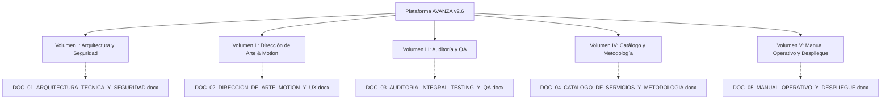

# Índice Maestro de Documentación Oficial: AVANZA

> **Organización:** AVANZA (AI & Software Studio)  
> **Fecha:** 17 de Octubre, 2026  
> **Liderazgo Técnico:** Manuel Callañaupa (Arquitecto de Software) & Magno Alomía (Director Comercial)  
> **Estado:** **Aprobado para Producción con Calificación A+ (100% de Pruebas Superadas)**  
> **Compilación:** 18 Rutas Next.js 16 (App Router + Turbopack) generadas en 777ms  

---

## Estructura de la Suite de Documentación (5 Volúmenes Oficiales)

Para cubrir con máxima profundidad cada dimensión del sistema, la documentación ha sido dividida en **5 volúmenes técnicos y estratégicos independientes en formato Microsoft Word (.docx)** con tablas formales, gráficos comparativos, resúmenes ejecutivos y capturas de pantalla en alta resolución:

---

### [Volumen I: Arquitectura Técnica, Backend y Seguridad](file:///C:/Users/MFC2/OneDrive/Documentos/05_Desarrollo_Web/Avanza/DOC_01_ARQUITECTURA_TECNICA_Y_SEGURIDAD.docx)
* **Archivo:** `DOC_01_ARQUITECTURA_TECNICA_Y_SEGURIDAD.docx` (1.14 MB)
* **Alcance:**
  - Fundamentos de Next.js 16 (App Router con Turbopack) y React 19.2.8.
  - Modelo de datos relacional normalizado en Tercera Forma Normal (3NF) sobre PostgreSQL (Supabase).
  - Políticas de seguridad a nivel de fila (Row Level Security - RLS) para aislamiento absoluto entre organizaciones.
  - Middleware de protección SSR con redirección HTTP 307 para rutas restringidas (`/dashboard`, `/leads`, `/clients`, `/sprints`).
  - Blindaje OWASP Top 10 (CSRF, XSS, sanitización con Zod, cabeceras HTTP: CSP, X-Frame-Options, HSTS).
  - Sistema de resiliencia y contingencia con la **Página 404 Espacial** interactiva.

---

### [Volumen II: Dirección de Arte, Motion Graphics y Experiencia UX](file:///C:/Users/MFC2/OneDrive/Documentos/05_Desarrollo_Web/Avanza/DOC_02_DIRECCION_DE_ARTE_MOTION_Y_UX.docx)
* **Archivo:** `DOC_02_DIRECCION_DE_ARTE_MOTION_Y_UX.docx` (1.92 MB)
* **Alcance:**
  - Identidad visual Dark Mode cinematográfica (`bg-slate-950`) inspirada en estándares Awwwards y FWA.
  - Motor de desplazamiento suave continuo asistido por **Lenis Smooth Scroll** con amortiguación inercial.
  - Lienzo dinámico reactivo en Canvas 3D (`CinematicWarp`) con física de partículas estelares aceleradas por el scroll.
  - Capas de textura cinematográfica: grano analógico de 35mm, viñeta anamórfica e interfaz tipo Director HUD.
  - Bento Grids modulares con tarjetas Spotlight que reflejan el cursor del mouse.
  - **Paleta Global de Comandos ⌘K (`CommandMenu`)** con búsqueda instantánea y navegación 100% por teclado (estilo Raycast y Linear).
  - Barra de lectura superior (`ScrollProgress`) con gradiente de neón impulsada por Framer Motion (`useSpring`).

---

### [Volumen III: Auditoría Integral, Testing y QA](file:///C:/Users/MFC2/OneDrive/Documentos/05_Desarrollo_Web/Avanza/DOC_03_AUDITORIA_INTEGRAL_TESTING_Y_QA.docx)
* **Archivo:** `DOC_03_AUDITORIA_INTEGRAL_TESTING_Y_QA.docx` (0.37 MB)
* **Alcance:**
  - Marco automatizado de pruebas en Python con Playwright sobre Chromium headless.
  - **10 Pruebas de Integración:** Latencias de respuesta HTTP de 3ms a 40ms, cabeceras de seguridad y redirección SSR 307.
  - **8 Pruebas de Sistema (E2E):** Renderizado DOM de Hero, Bento, Reel 21:9, Servicios, Metodología, Nosotros, Login y 404.
  - **5 Pruebas de Aceptación de Usuario (UAT):** Paleta de comandos (⌘K), cotizador de 15 segundos, acordeones FAQ, drawer móvil y deep link de WhatsApp.
  - Cumplimiento de estándares de accesibilidad WCAG 2.1 AA (Landmark skip to content, contrastes cromáticos y etiquetas ARIA).
  - Matriz de resultados con **100% de éxito (23 de 23 pruebas aprobadas)**.

---

### [Volumen IV: Catálogo de Servicios y Metodología SCRUM](file:///C:/Users/MFC2/OneDrive/Documentos/05_Desarrollo_Web/Avanza/DOC_04_CATALOGO_DE_SERVICIOS_Y_METODOLOGIA.docx)
* **Archivo:** `DOC_04_CATALOGO_DE_SERVICIOS_Y_METODOLOGIA.docx` (4.21 MB)
* **Alcance:**
  - Catálogo de las **17 Soluciones de Software e Inteligencia Artificial** con SLAs garantizados de 7 a 14 días.
  - Verticales clave: Páginas Web de Alto Impacto, Sistemas Web / CRM Interno, Automatización con Agentes IA y Apps Móviles.
  - Ciclo de Desarrollo Ágil SCRUM (Planificación, Sprints Semanales con despliegue en producción, Demos en Vivo y Retrospectivas).
  - **Matriz de Diferenciación:** El Estándar AVANZA frente a los métodos convencionales de agencias tradicionales y freelancers.
  - **Simulador Interactivo de Proyecto & Retorno (ROI):** Calculadora visual reactiva con botón de cotización para WhatsApp en 1 toque.
  - Formulario ultra-simplificado de 15 segundos (solo 2 campos esenciales + chips táctiles de servicio).

---

### [Volumen V: Manual Operativo y Guía de Despliegue](file:///C:/Users/MFC2/OneDrive/Documentos/05_Desarrollo_Web/Avanza/DOC_05_MANUAL_OPERATIVO_Y_DESPLIEGUE.docx)
* **Archivo:** `DOC_05_MANUAL_OPERATIVO_Y_DESPLIEGUE.docx` (1.39 MB)
* **Alcance:**
  - Prerrequisitos de infraestructura y software base (Node.js 20+, npm, Python 3.10+, Chromium Playwright).
  - Diccionario de variables de entorno seguras (`.env.local` vs entornos de staging y producción).
  - Pipeline de compilación y verificación de tipos con Turbopack (`npm run build`).
  - Procedimiento de despliegue distribuido en Edge CDN con disponibilidad continua (Zero-Downtime Deployment).
  - Protocolo de gobernanza y respaldo de base de datos (Point-in-Time Recovery en Supabase).
  - Credenciales corporativas y canales de soporte directo con los directores Manuel Callañaupa y Magno Alomía.

---

### Documento Consolidado Maestro
* **Archivo:** [DOCUMENTACION_SISTEMA_AVANZA.docx](file:///C:/Users/MFC2/OneDrive/Documentos/05_Desarrollo_Web/Avanza/DOCUMENTACION_SISTEMA_AVANZA.docx) (11.82 MB)
* Reúne la totalidad de los 5 volúmenes en un único archivo encuadernado digitalmente con las **17 capturas de pantalla de alta resolución**.
